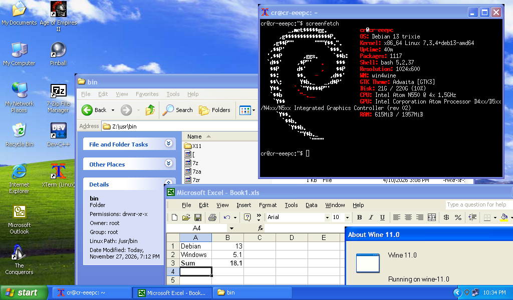
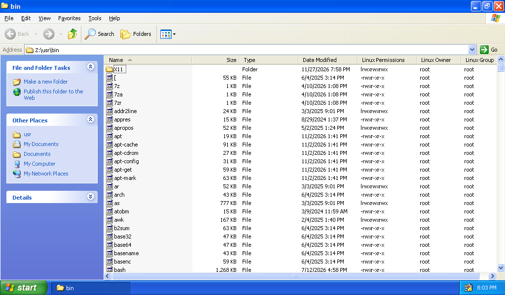
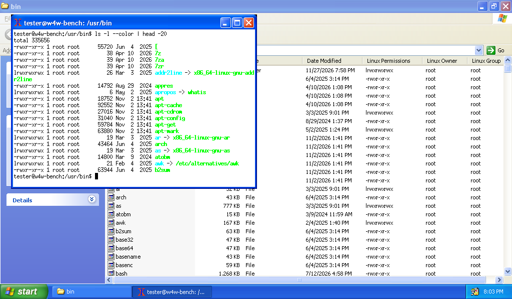

<h1 align="center">LunaticOS</h1>
<p align="center">
  <strong>A Windows XP desktop for old netbooks, built on Debian.</strong>
</p>
<p align="center">
  
</p>
<p align="center">
  <a href="LICENSE"></a>
  
  
  
</p>

LunaticOS turns a Debian machine into a Windows XP desktop. XP's own `explorer.exe` runs on a patched Wine as the
**desktop shell of Linux**: the taskbar, Start menu, desktop and folder windows are XP's real ones, and Linux applications get
XP's frames and taskbar buttons beside the Windows programs.

It is made for **low-end and older notebooks**, and tuned on an Asus EeePC 1015PEM (Atom N550, 2 GB RAM, 1024x600): it should
start reliably, respond quickly on a netbook CPU and fit a small screen.

No Microsoft files are included. You bring your own Windows XP ISO, and only the files that are needed are extracted from it,
locally.

What it can do, in pictures: [docs/showcase.md](docs/showcase.md).

> [!IMPORTANT]
> **This is a personal, experimental project**, not a finished product for daily use.
> It is only tested on a **freshly installed Debian 13** set up with the installation script. Installing it on a system already
> in use (with another desktop environment or display manager, for example) has not been tried.

## Install

1. Get a Windows XP Professional SP3 (x86) ISO **yourself**. English XP is the one tested here.
2. On a freshly installed Debian 13, run as the user who will log in:

   ```sh
   git clone https://github.com/chrisnew/LunaticOS.git ~/lunaticos
   cd ~/lunaticos
   scripts/setup.sh --media /path/to/WindowsXPSP3.iso --greeter
   ```

3. Reboot. The XP Welcome screen logs you straight into the XP desktop.

The script builds Wine, which takes about 90 minutes on 4 cores and far longer on a netbook. On a slow machine, build it on a
faster Debian 13 machine and pass its `.local/wine-install` with `--wine-install DIR`.

Details, all options and how to change the theme or the text size later:
[the installation guide (INSTALL.md)](INSTALL.md).

## What it does

**XP's desktop**
- XP's Luna (or Classic) taskbar, Start menu, desktop, My Computer and folder windows, with the folder task pane, image
  thumbnails and previews.
- XP's Welcome screen as the login screen (LightDM), XP's big "welcome" screen while the desktop starts, and XP's sounds.
- Display Properties with XP's themes, styles and colour schemes, XP's screen savers, and a lock screen behind the Welcome
  screen (Win+L).
- XP's keys: the Windows key, Ctrl+Esc, Win+R, Win+E and Win+L, and Alt+Tab over all windows.
- Internet Explorer 6, Windows Media Player 9, Network Connections and the Start menu's Internet and E-mail entries, all from
  your own ISO.

**Linux inside XP**
- Linux windows and dialogs get XP's frames; the taskbar, Alt+Tab, minimize, maximize and full screen work as on XP.
  Linux applications are listed under All Programs.
- The notification area shows Linux tray icons beside XP's own network, battery and volume icons, with XP's flyouts fed by
  NetworkManager and PipeWire or PulseAudio. The wireless network list connects through XP's network key dialog.
- XP's folder windows show a Linux file's permissions, owner, group and path as columns, and a folder's context menu opens a
  Linux terminal there.
- A double click on an `.iso` file mounts it as a CD drive, and Eject takes it away again.
- My Network Places lists what the local network announces (mDNS and UPnP): web pages open in the Linux browser, SSH servers
  in a terminal.
- The keyboard layout follows XP's Regional and Language Options, and Left Alt+Shift switches between input languages as on XP.

**Windows programs**
- A WoW64 Wine 11.0 runs 32-bit and 64-bit programs. Run `wine setup.exe` in a terminal and the installer's shortcuts land in
  XP's Start menu.

**When things go wrong**
- If the XP shell keeps crashing, the session falls back to Wine's own explorer and an xterm.

<table>
  <tr>
    <td align="center" width="50%">
      <br />
      Linux permissions, owner and group in XP's folder windows
    </td>
    <td align="center" width="50%">
      <br />
      A Linux terminal opened from a folder, in an XP frame
    </td>
  </tr>
  <tr>
    <td align="center" colspan="2">
      <br />
      XP's classic theme (<code>--theme classic</code>)
    </td>
  </tr>
</table>

## How it works

```text
LightDM ─ XP Welcome greeter (greeter/)
   └─ XP Shell session (session/supervisor.py)
        ├─ Wine 11.0 + 165 patches (wine/patches/)
        │    └─ XP's explorer.exe, shell32.dll, … (extracted from your ISO)
        ├─ bridge-wm: an X11 WM + Win32 proxy windows (bridge-wm/)
        └─ tray bridge (bridge-wm/tray.py)
```

How the parts fit together is in [docs/architecture.md](docs/architecture.md), and why they are built that way in
[docs/design.md](docs/design.md). All documents are listed in [docs/README.md](docs/README.md); building and testing is in
[docs/development.md](docs/development.md).

## Also in the code, from upstream

LunaticOS is a fork of [win4wine](https://github.com/mikuta0407/win4wine), which also runs the ReactOS and Windows 7 shells.
LunaticOS has removed those and keeps to XP. These parts from upstream are still there but are not what LunaticOS aims at,
so they are tested less here:

- A Wayland session on a patched labwc (`--wayland`, even more experimental; [docs/wayland.md](docs/wayland.md)).
- Japanese XP, with Japanese input through fcitx5 and Mozc.

In paths, settings, environment variables and the repository, the project still uses upstream's name, `win4wine`
(`~/.config/win4wine`, `WIN4WINE_*`, `win4wine-wine`), so that both stay compatible.

## Ground rules

- Binaries from Windows are used as they are extracted and never modified; differences are handled in Wine and around it.
- Microsoft binaries are never disassembled. Behaviour is studied through public APIs, public documentation and our own probes
  on a real XP.
- Microsoft files, extracted files and prefixes live only in `localres/` and `.local/`, which Git ignores.

## Caution

> [!WARNING]
> - **Obtain the Windows XP ISO yourself.** Neither this repository nor its scripts download any Microsoft files.
>   Follow Microsoft's license terms for the ISO and the files extracted from it.
> - **Use at your own risk.** The author is not responsible for data loss or any other problems.
> - Only XP Professional SP3 (x86) in English is tested here (Japanese worked upstream). XP in other languages is set up like
>   English XP and might work, but has not been tested at all (`setup.sh` warns and goes on).

LunaticOS is an unofficial project, not affiliated with or endorsed by Microsoft, the Debian Project or the Wine project.
Windows and Windows XP are trademarks of Microsoft Corporation. Debian is a registered trademark of Software in the Public
Interest, Inc. No Microsoft files are included; you supply your own XP installation media.

## Similar projects

- [loss32](https://loss32.org/): a planned Linux distribution whose desktop is made only of Win32 software on Wine,
  with parts of ReactOS. While LunaticOS runs XP's own shell on Debian, loss32 is built from free software only.

## Credits

- [mikuta0407](https://github.com/mikuta0407) created [win4wine](https://github.com/mikuta0407/win4wine), on which LunaticOS
  is built; most of what is described here comes from it.
- [AshesTom](https://github.com/AshesTom) ([fork](https://github.com/AshesTom/win4wine)): XP's Display Properties, sounds,
  keyboard layouts, XP's own notification area icons, the Start menu's left column, Internet Explorer 6 and Windows Media
  Player 9, the welcome screen while the shell starts, caption animation and small icons, and more.

## License

[LGPL-2.1-or-later](LICENSE), the same as Wine. It covers only the code and patches in this repository,
except `wayland/patches/labwc/` (GPL-2.0-only, as labwc) and `wayland/patches/wlroots/` (MIT, as wlroots).
The Windows XP files, and the XP screens in the screenshots, are copyrighted by Microsoft.
