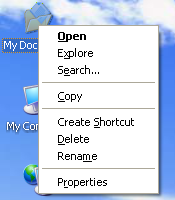
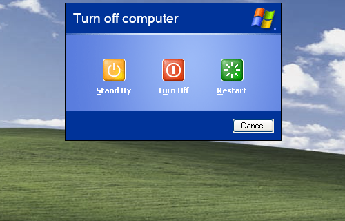
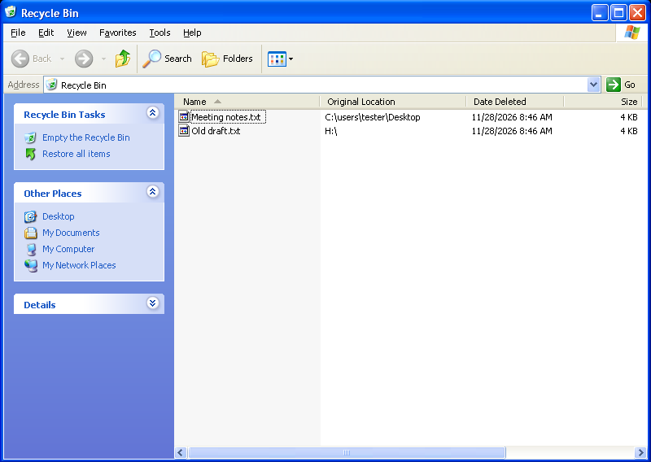
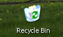
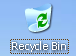
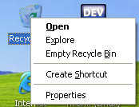

# What there is to see

A picture of each thing this fork added, newest first, so that you can see what the XP session on the EeePC can do without
starting it, and what to show at the event. Every feature that changes what is on the screen adds its picture here in the commit
that builds it (how: [`.claude/skills/screenshots`](../.claude/skills/screenshots/SKILL.md)).

Each picture says where it was taken: **EeePC** (the real machine, 1024x600) or **bench** (the session in Docker on Xvfb at
1024x600, [`tools/bench`](../tools/bench/bench.sh); the same Wine and shell, but another user name, no sound, no network devices
and few Linux apps). The pictures are in [images/showcase/](images/showcase/). The XP screens in them are copyrighted by
Microsoft.

## My Documents on the desktop

My Documents on the desktop opens by double click again and has XP's context menu. Delete there removes only the icon,
after XP's own question.

*Bench, 2026-11-28 (the commit that adds this picture).*

## Alt+F4 on the desktop

With the desktop active (clicked, or after the last window was closed), Alt+F4 opens XP's "Turn off computer", as on XP.

*EeePC, 2026-11-28 (repo 5805617).*

## The desktop on the EeePC

The whole desktop on the machine it is made for: an xterm with screenfetch on Debian 13, Excel 2002 from Office XP, XP's folder
window on `/usr/bin` with the Linux details, and Wine's About box, side by side on XP's taskbar. It is the README's main picture.

*EeePC, 2026-11-27 (repo dc08256).*

## Open in Linux Terminal

The context menu of a folder's background opens a Linux terminal in that folder. The terminal gets an XP frame and a taskbar
button like any Windows program ([plans/linux-terminal.md](../plans/linux-terminal.md)).

*Bench, 2026-11-27 (repo f21ec45).*

## Disc images

An `.iso` file has its own icon, and a double click mounts it as a CD drive; Eject takes it away again
([plans/iso-mount.md](../plans/iso-mount.md)). The icon is ours, drawn after the
[icon guide](../XP-Style%20Icon%20Guide.md).

*Bench, 2026-11-27 (repo f21ec45): the icon only, because the bench cannot mount (no UDisks2 or loop devices).*

## Linux columns

XP's folder windows show a Linux file's permissions, owner, group and path (the header's context menu adds them)
([plans/linux-columns.md](../plans/linux-columns.md)).

*Bench, 2026-11-27 (repo f21ec45).*

## Recycle Bin

Deleted files go to XP's Recycle Bin, from drive C: and from the home folder (drive H:), and can be restored or emptied for
good. The desktop icon shows whether it is empty, and its menu has Empty Recycle Bin
([plans/recycle-bin.md](../plans/recycle-bin.md)).

  

*EeePC, 2026-11-28 (repo 05e7ff0).*

## Not pictured yet

These are built and on the EeePC, and still need their picture, best taken there: My Network Places with the home network's
devices ([plan](../plans/network-places.md)), the screen savers and the lock screen ([plan](../plans/screensaver-and-lock.md)),
Internet Explorer 6, Customize Notifications and the notification area's chevron, and the Start menu's Linux apps.
