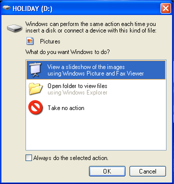

# Plan: USB sticks, SD cards and disc images as removable drives, with XP's hotplug UI

Status (2026-11-28): phases 1 to 4 are built, **on the EeePC and confirmed working** there with real media. Some of it is
still to be tried, and a fix waits to be deployed: read [As built](#as-built-2026-11-28) first, the sections after it are
the plan as it was made.

Goal: plugging a USB stick (or an SD card into the card reader) into the EeePC goes the way it went on XP:

1. XP's "hardware inserted" sound, and the first time this stick is seen, the **Found New Hardware** balloons ("USB Mass
   Storage Device", then "Your new hardware is installed and ready to use.").
2. A **Removable Disk** in My Computer, under "Devices with Removable Storage", with its label and XP's removable drive icon.
3. XP's **AutoPlay** dialog ("What do you want Windows to do?") with the actions that fit what is on the stick: open the
   folder, view a slideshow of the pictures, take no action, and "Always do the selected action".
4. The **Safely Remove Hardware** icon in the notification area while a stick is in. Its menu ("Safely remove USB Mass Storage
   Device - Drive(E:)") or XP's own **Eject** on the drive unmounts the stick and powers it off, and the balloon says "The 'USB
   Mass Storage Device' device can now be safely removed from the system."
5. Pulling it out, with or without ejecting first, plays the "hardware removed" sound and the drive goes.

**Disc images get the same lifecycle** ([plans/iso-mount.md](iso-mount.md)): mounting an `.iso` plays the sound and
starts AutoPlay. A disc with an `autorun.inf` runs its AutoRun, as a CD did on XP, which finishes that plan's phase 3. The
mounted image is listed in Safely Remove Hardware too, and ejecting it there works as XP's Eject does. Linux programs see
sticks at `/media/cr/LABEL`, as they see the images.

For the demo, a visitor plugs in their own stick and gets the sound, the balloon and the AutoPlay dialog, then sees their
pictures in XP's slideshow. Or they double-click `Office XP.iso` and the Office XP setup screen appears.

## As built (2026-11-28)

How it works is in [docs/architecture.md](../docs/architecture.md#removable-drives-sessionremovablepy), the pictures are in
[docs/showcase.md](../docs/showcase.md#usb-sticks-and-memory-cards).

The order changed: with the bench first, phase 0 was done there as far as it could be, with a fake UDisks2
([tools/bench/udisks-mock.py](../tools/bench/udisks-mock.py), loop device nodes bound as `/dev/sdb` and so on).

- **Phase 0, read only on the EeePC.** The empty card reader has **no block device**, so no phantom drive. A stick plugged
  in at 11:31 that day had left `i:: -> /dev/sdb`, `j:: -> sdb2` and `k:: -> sdb1`: a letter for the whole disk, and letters
  that stay taken (D: to G: were held by old disc images' links too). The prefix has the `DeviceConnect` sounds and only
  Media Player's AutoPlay handlers; `hotplug.dll`, `newdev.dll` and `shsvcs.dll` were not extracted.
- **XP's Eject on a stick** (traced on the bench) locks the volume (a stub in `ntdll`), then sends
  `IOCTL_STORAGE_MEDIA_REMOVAL`, then `IOCTL_STORAGE_EJECT_MEDIA`. No dismount.
- **Three patches, not one**: 0168 (the drive; the serial number was dropped by `add_dos_device`, and vendor, product, bus
  and FAT serial were missing), 0169 (Eject), 0170 (letters freed, left-over drives removed). `kernelbase` needed nothing.
  FAT and exFAT report as FAT32.
- **No IPC from `removable.py`**: "not formatted" is `xptray.exe --not-formatted E:`, and `xptray.exe` tells an eject from a
  pulled stick by the order of the messages (unmounted before the letter went).
- **The Safely Remove icon** is `stobject.dll`'s (210), already extracted; `hotplug.dll` gives the balloon's and message's
  texts. A click shows the menu; XP's own window was not tried (no device tree).
- **XP's AutoPlay service was not run.** Decided from Wine's code: `mountmgr` registers no volume device interfaces, so
  `ShellHWDetection` would hear of no drive, and that is more than one small patch. Ours uses XP's templates 1120 and 1121.
- **The slideshow** is XP's viewer with F11 sent to it. **The wait before a folder window** had to be 3.5 s (2.6 s too short
  on the bench).

**On the EeePC** (repo ccaa301, the same day): confirmed working, among other things with a USB stick holding a `dd`'d
Debian image and a Raspberry Pi's SD card, both of whose partitions appeared. From `udisksctl monitor` meanwhile:

- The card reader is a USB drive ("Multiple Card Reader") that appears **only with a card in it**; the card is `sdb`
  with partitions, not `mmcblk`. vfat and ext4 were both mounted.
- A stick was mounted 0.8 s after it was seen, the card's two partitions 1.9 s after.
- A stick that was ejected was unmounted and gone half a second later: **power-off works without a password**.
- A card pulled out sent **no "unmounted" before "removed"**, which is how `xptray.exe` tells it from an eject.
- **Idle**, no stick in: nothing new in the sample ([tools/eeepc/README.md](../tools/eeepc/README.md#removable-drives)).
- **The hybrid stick's whole disk** said it held a file system, without a `Filesystem` interface, and got an empty CD
  drive. Fixed in 0168, **not yet deployed**.

**Still open, on the EeePC:**

1. Deploy the 0168 fix (a new Wine).
2. The sounds play, and disc images work (AutoRun and Eject, reported by the user). To try: an exFAT or NTFS stick,
   Shift, and the time to the AutoPlay dialog.
3. To try: a stick with music or video. Windows Media Player does not start in the bench (BUGS.md), and "Play" depends
   on it.
4. EeePC pictures in place of the bench ones.
5. Encrypted drives do nothing: [Encrypted drives](#encrypted-drives-luks-not-built).

## Encrypted drives (LUKS): not built

Plugging in a LUKS drive shows nothing at all. Seen on the EeePC 2026-11-28 with a USB hard disk: its partition is
`IdUsage` `crypto` with an `Encrypted` interface (`CleartextDevice` `/`) and no `Filesystem`, so mountmgr gives it no
letter (0168) and `removable.py` passes it over. Unlocking it by hand would not help: the unlocked device (`dm-N`) belongs to
no drive of its own (to be checked), and both halves look for a removable one. It was not part of the plan's scope.

What it would take:

- `removable.py`: on a locked partition of a removable drive, ask for the passphrase and unlock it (`udisksctl unlock
  --key-file`, a file in `$XDG_RUNTIME_DIR` that is deleted at once, or the same call over D-Bus without a file). polkit
  allows `encrypted-unlock` to the active session without a password (checked on the EeePC). Follow
  `CryptoBackingDevice` to the drive to mount what appears.
- A passphrase dialog in XP's style (XP had nothing for this, so it is ours), with Cancel leaving the drive locked and a
  message for a wrong passphrase. Safely Remove Hardware should list a drive that stays locked.
- mountmgr (a change to 0168): take the removable drive of the `CryptoBackingDevice` for the unlocked device, so that it
  is a Removable Disk.
- Eject (a change to 0169): unmount, **lock** (`udisksctl lock`), then power off.
- To probe: what UDisks2 reports once unlocked, and what is left behind when the drive is pulled out unlocked.

## What exists

- **The ISO work did most of the plumbing** ([plans/iso-mount.md](iso-mount.md),
  [docs/architecture.md](../docs/architecture.md#disc-images-sessioniso_mountpy)). `udisks2` is on the EeePC
  (`tools/eeepc/LOG.md`, 2026-11-27), polkit lets the `seat0` session mount without a password, and Wine's `mountmgr.sys`
  follows UDisks2 on the system bus. Patches 0162 (only UDisks2's own signals), 0163 (arrival and removal are announced
  correctly as `WM_DEVICECHANGE`, so XP's Explorer adds and drops drives) and 0164 (Eject on a loop CD unmounts it with
  `udisksctl`) are in place.
- **Why nothing happens today** (read in `dlls/mountmgr.sys/dbus.c` and `device.c`, Wine 11.0 with our patches):
  - **Nothing mounts the stick.** A Linux desktop runs an automounter (GNOME's gvfs, udiskie, ...); this session has none.
    UDisks2 sees the stick, but its file system has no mount point.
  - **mountmgr gives it a drive letter anyway, of the wrong kind.** `udisks2_add_device` queues `ADD_DOS_DEVICE` for every
    block device whose drive has `Removable` set. The drive type comes from `MediaCompatibility`, which is empty for a USB
    stick, so it stays `DEVICE_UNKNOWN`. Only `iso9660` and `udf` get a type of their own. For `DEVICE_UNKNOWN`,
    `query_unix_drive` reports `DRIVE_UNKNOWN`, and `GetDriveTypeW` (kernelbase) then reports a drive that cannot be opened
    as `DRIVE_NO_ROOT_DIR`. Once it is mounted, the drive is `DRIVE_FIXED`, because ntdll marks only CD and floppy file systems
    `FILE_REMOVABLE_MEDIA`. So it would be a "Local Disk" with a hard disk icon, not a Removable Disk.
  - **Probably too many letters.** The same code runs for the whole disk (`/dev/sdb`, with a partition table and no file
    system) and for each partition (`/dev/sdb1`), and for a card reader with no card in it. That would be one letter that
    cannot be opened, next to the real one. Phase 0 checks this.
  - **Eject does nothing** for a stick: 0164 handles loop devices that are CD or DVD drives only, and answers the rest as
    before (unsupported).
- **XP's hotplug UI is not running.** On XP the Safely Remove Hardware icon came from `stobject.dll` (in `systray.exe`,
  using `hotplug.dll`), the Found New Hardware balloons from the PnP manager (`newdev.dll`), and AutoPlay from the Shell
  Hardware Detection service (`shsvcs.dll`). Wine has no PnP device tree and does not run that service. The ISO work found
  that XP's Explorer looks for `autorun.inf` and does not read it.
- **`xptray.exe`** ([xp-explorer/helpers/xptray.c](../xp-explorer/helpers/xptray.c)) is already our `systray.exe`: XP's
  network, power and volume icons and flyouts, from XP's own icons extracted into `C:\xp\tray`, sent to XP's tray in XP's
  `WM_COPYDATA` format, **with balloons** (`NIF_INFO`). It starts from the `Run` key that `prefix/extras.py` writes. The
  Safely Remove icon belongs there, as it did on XP.
- **The other pieces to reuse:** `session/iso_mount.py` (`udisksctl` with `--no-user-interaction` and error texts),
  `linux-launch.exe` and how it opens a drive window (`xp-explorer.exe` with the path, after a wait of 2 s), and the
  supervisor's way of starting `session/network_places.py` (a setting in `session.json`, the log, stopped with the session).

## Decisions

- **Linux mounts the stick, through UDisks2**, at `/media/cr/LABEL`, as for the ISOs. Wine never reads the block device.
  The stick is visible to Linux programs too, and UDisks2's mount options are the ones every Linux desktop uses (for FAT,
  `flush`, which makes pulling a stick out early less harmful).
- **Two halves, Linux and Windows, linked only by mountmgr's notifications:**
  - **`session/removable.py`** (Linux, started by the supervisor like `network_places.py`) only mounts. It runs one
    `udisksctl monitor` (blocking reads, no polling, so no idle wakeups on the Atom), and mounts each new removable file
    system.
  - **The Windows side** reacts to `WM_DEVICECHANGE`, which mountmgr broadcasts for sticks and disc images alike (0163). It
    plays the sounds, shows the balloons and the Safely Remove icon (in `xptray.exe`), and runs AutoPlay (a new
    `autoplay.exe` in `C:\xp\bin`, which xptray starts for each arrival). It uses Windows APIs only: `GetDriveTypeW`,
    `GetVolumeInformationW`, `PlaySoundW` with XP's sound events, and `IOCTL_STORAGE_EJECT_MEDIA` as XP's Eject does. So it
    does not care who mounted the drive, and the same code covers ISOs, sticks and SD cards.
  - **Not chosen for now:** mounting from mountmgr, a Wine patch. The helper can be changed and tested without a Wine build.
    It can move into Wine later if we decide so (`removable.py` is small, and nothing on the Windows side would change).
    Not chosen: `udiskie`, which pulls in GTK and whose notifications are not XP's.
- **mountmgr is fixed so the drive is right** (Wine patch, phase 1): a removable drive's partition with a file system becomes
  `DEVICE_HARDDISK`, which mountmgr already reports as `DRIVE_REMOVABLE`. Whole disks with a partition table, block devices
  with no file system or a size of 0 (an empty card reader), and those UDisks2 marks `HintIgnore` or `HintSystem` get no
  letter. Loop devices are unchanged (their drive is not removable).
- **Only removable drives on USB or the card reader.** Internal hard disk partitions are not added (that is today's
  behaviour, which stays). Only file systems that Linux mounts from the session: FAT, exFAT, NTFS (`ntfs-3g` and `exfatprogs`
  came with `udisks2`), and ext4. On ext4 the files keep their owners, so a stick from another Linux machine may be read-only.
- **The drive letter is the first free one from `D:`**, as Wine chooses it, as for the ISOs.
- **Sounds:** `DeviceConnect` on arrival and `DeviceDisconnect` on removal, from the user's sound scheme
  (`PlaySoundW(..., SND_ALIAS | SND_ASYNC)`), so XP's Sounds control panel changes them. Played for sticks and for disc
  images, as XP played them for a USB CD drive. Not for a stick or image that was already there at logon.
- **Found New Hardware** only for real hardware, the first time a stick or card reader is seen. Devices are told apart by the
  drive's serial (`IOCTL_STORAGE_QUERY_PROPERTY`, which mountmgr fills from UDisks2's `Drive.Id`), with the volume serial
  as a fallback, kept under `HKCU\Software\win4wine\Hotplug\Seen`. Not for disc images: on XP a new CD did not give it either.
- **Safely Remove Hardware** lists every removable drive and mounted image. Its texts are XP's: "Safely remove USB Mass
  Storage Device - Drive(E:)", and for an image "Safely remove Disc Image - Drive(D:)" (ours: XP had no disc images). Its
  icon shows while at least one is listed. A click on an entry ejects it, the same request as XP's Eject, and shows XP's "Safe
  To Remove Hardware" balloon, or if the drive is busy, XP's "Problem Ejecting USB Mass Storage Device" message ("The device
  'Generic volume' cannot be stopped right now. Try stopping the device again later.").
- **Eject is XP's own**, on the drive's menu, extending 0164: for a removable drive that is not a loop device, unmount
  (`udisksctl unmount`) and power off the drive (`udisksctl power-off`). The stick's light goes out and the letter goes.
  Busy: `STATUS_DEVICE_BUSY`, as for the ISOs.
- **AutoPlay, in two steps:** first a time-limited probe of **XP's own** (the Shell Hardware Detection service from
  `shsvcs.dll`, with XP's handlers), because nothing could look more like XP. If it does not run under Wine within a day,
  **ours**: `autoplay.exe`, the same dialog built after XP's, run with XP's own handler entries
  (`HKLM\...\Explorer\AutoplayHandlers`) where the prefix has them. Phase 4 says how.
- **AutoRun (`autorun.inf`) is run only from CDs and disc images**, as XP did: its `open=` or `shellexecute=` line, from the
  drive's root, unless Shift is held while the disc arrives (XP's way of skipping it). **From sticks it is never run**: these
  are visitors' sticks at a public event, and Windows 7 stopped running it from sticks for the same reason. Sticks get the
  AutoPlay dialog without an AutoRun entry.
- **The ISO launcher stops opening its own window for a new image** when AutoPlay is on: AutoPlay does that (or AutoRun).
  An image that was already mounted still opens its drive, as now.
- **Only the XP shell.** The other shells are left as they are.

## Phase 0: probes on the EeePC (after asking; nothing is installed, so there is nothing for `tools/eeepc/LOG.md` unless a rule is added)

Use one FAT stick, one exFAT or NTFS stick, and an SD card in the card reader.

1. Before plugging in: `udisksctl dump`. Is there a block device for the empty card reader, and what are its `Size`, `Drive`,
   `Removable` and `MediaRemovable`? Does XP's My Computer already show a drive for it? (If so, that is today's first bug.)
2. Plug in the FAT stick. Note what UDisks2 reports (`udisksctl monitor` in the session's terminal), what mountmgr does
   (`winedevice.exe:+mountmgr` in `session.json`'s `debug`), and which letters appear in My Computer, with which name and
   icon. Keep the output of `udisksctl monitor` and `dump` as test data for `tests/removable.py`.
3. In the session's terminal (Open in Linux Terminal, not over ssh, for polkit): `udisksctl mount -b /dev/sdb1`, then
   `udisksctl unmount -b /dev/sdb1` and `udisksctl power-off -b /dev/sdb`. All three must work without a password. Note the
   times on the Atom and whether XP's drive follows each step.
4. With the stick mounted: XP's Eject on its drive, with `xp-explorer.exe:+file,winedevice.exe:+mountmgr`. Does it send
   `IOCTL_DISK_EJECT_MEDIA` to the volume as for the ISOs, or something else (`IOCTL_STORAGE_EJECT_MEDIA`, a lock and a
   dismount first)? The patch in phase 2 handles what arrives.
5. Pull the stick out while mounted, with a window of it open. Does UDisks2 clean up the mount, does the letter go, and what
   happens to the window?
6. **What the Windows side can get** (a small probe program, `tests/hotplug-probe.c`, kept for later): which
   `WM_DEVICECHANGE` messages a top-level window receives for a stick and for an image (`DBT_DEVICEARRIVAL` with
   `DBT_DEVTYP_VOLUME` and its unit mask), and what `IOCTL_STORAGE_QUERY_PROPERTY` returns (bus type, vendor, product,
   serial).
7. **What the prefix has** (read only): `HKLM\Software\Microsoft\Windows\CurrentVersion\Explorer\AutoplayHandlers`,
   the `DeviceConnect` and `DeviceDisconnect` entries of the sound scheme, and whether `shsvcs.dll`, `hotplug.dll` and
   `newdev.dll` were extracted (their icons are wanted even if the programs are not).
8. Undo: `session.json` restored.

## Phase 1: the right drive in My Computer (Wine patch 0168)

1. **The patch**, `mountmgr: USB sticks and memory cards are removable disks`, in `dlls/mountmgr.sys/dbus.c`
   (skill `wine-patch`):
   - In `udisks2_add_device`, also read `IdUsage` (Block), `HintIgnore` and `HintSystem` (Block), `Size` (Block) and
     `ConnectionBus` (Drive, through `udisks2_get_drive_info`).
   - A removable drive whose type stays `DEVICE_UNKNOWN` and which has a file system (`IdUsage` is `filesystem`) becomes
     `DEVICE_HARDDISK`. One with no file system, a size of 0, or either hint gets no letter.
   - Nothing else changes: CDs (`MediaCompatibility`), ISO loop devices, and non-removable volumes are as before.
2. **If phase 0 shows that a mounted stick is still `DRIVE_FIXED`** in XP (if `GetDriveTypeW` asks ntdll before mountmgr for a
   drive that can be opened, which the code suggests): the same patch adds, in `get_mountmgr_drive_type`'s caller in
   kernelbase, that mountmgr's `DRIVE_REMOVABLE` wins over a disk file system with no flags. Or ntdll sets
   `FILE_REMOVABLE_MEDIA` when `/sys/dev/block/MAJ:MIN/../removable` is 1, if that is the smaller change. Decide in phase 0
   with the trace.
3. **If phase 0 step 6 shows that `IOCTL_STORAGE_QUERY_PROPERTY` has no vendor, product or serial** for these drives, the
   patch fills them from UDisks2's `Drive.Vendor`, `Drive.Model` and `Drive.Id`, for the balloons and Found New Hardware.
4. **Test** with the probes of phase 0: one letter per stick, "Removable Disk (E:)" or the label, XP's removable drive icon,
   under "Devices with Removable Storage", and no drive for the empty card reader. Mounted by hand, the files open in XP.

## Phase 2: mounting on arrival, and Eject

1. **`session/removable.py`** (with a usage line at the top, as the other helpers):
   - Runs `udisksctl monitor` and, at start, reads `udisksctl dump` once for what is already there. Parses only the lines it
     needs (block device added, `IdUsage`, `MountPoints`, the drive's `Removable`). The same filter as the patch.
   - A new removable file system that is not mounted: `udisksctl mount --no-user-interaction -b DEVICE`.
   - A mount that fails (an unknown file system, a damaged one) is written to a file in the IPC directory, so that xptray
     can show XP's message: "The disk in drive E: is not formatted." The error also goes to the log.
   - Ends with the session; restarts `udisksctl monitor` if it dies, at most once a minute.
2. **The supervisor** starts it with a `removable` setting in `session.json` (default on), as `network_places`.
3. **Eject: extend 0164** (`mountmgr: eject unmounts and powers off USB sticks`, a new patch or 0164 changed, see
   [docs/patches.md](../docs/patches.md) for which): for a `DEVICE_HARDDISK` from UDisks2 that is not a loop device,
   `udisksctl unmount -b PARTITION`, then `udisksctl power-off -b DISK` (only if no other partition of the disk is mounted).
   The drive and its letter go when UDisks2 removes the device, which 0163 announces.
4. **Tests** in `tests/removable.py`, as `tests/iso_mount.py`: the parsing of `udisksctl monitor` and `dump` output (the
   test data from phase 0) and the filter. The Docker bench has no system bus or UDisks2, so the whole path is tested on the
   EeePC: the three media of phase 0, two sticks at once, a stick plugged in before logon, Eject with and without a window
   open, pulling out without Eject, and the time from plugging in to the drive on the Atom (into `tools/eeepc/README.md`).

## Phase 3: sounds, balloons and Safely Remove Hardware (in `xptray.exe`)

1. **Arrivals and removals**: xptray's window already gets `WM_DEVICECHANGE`. For `DBT_DEVICEARRIVAL` and
   `DBT_DEVICEREMOVECOMPLETE` of a volume it updates a list of removable drives and mounted images (`GetDriveTypeW`, label,
   and for sticks the vendor, product and serial). At start it fills the list without sounds or balloons.
2. **Sounds**: `DeviceConnect` and `DeviceDisconnect`, as in Decisions. If the prefix's scheme has no entries for them,
   `prefix/extras.py` adds XP's (`Windows XP Hardware Insert.wav` and `Windows XP Hardware Remove.wav`, from `C:\WINDOWS\Media`).
3. **Found New Hardware**: for a stick not in `Hotplug\Seen`, the two balloons from the tray, about 2 s apart, with XP's
   icon. On XP they came from the "Found New Hardware" icon, which shows for those seconds and goes.
4. **The Safely Remove Hardware icon**: a fourth icon (`ID_HOTPLUG`), XP's own from `hotplug.dll` or `shell32.dll`,
   extracted into `C:\xp\tray` by [extract/extract.py](../extract/extract.py). Tooltip "Safely Remove Hardware". A left click
   shows the menu of entries, as on XP. A double click opens XP's Safely Remove Hardware window only if phase 0 shows that
   `hotplug.dll`'s own window works without a PnP tree; otherwise the same menu.
5. **Ejecting**: `CreateFileW("\\\\.\\E:")` and `IOCTL_STORAGE_EJECT_MEDIA`, which reaches 0164 and its extension. Success:
   "Safe To Remove Hardware" balloon. `STATUS_DEVICE_BUSY` (a window or a program has the drive open): XP's message box.
   The balloon is shown after XP's own Eject too, when xptray sees the drive go without being pulled (UDisks2's power-off
   comes before the removal; `removable.py` writes that it happened to the IPC directory).
6. **Errors from `removable.py`** ("not formatted") as XP's message box.
7. **Test** on the EeePC: each of the above with a stick and with an image, and idle wakeups with no stick in (xptray must
   not gain a timer for this).

## Phase 4: AutoPlay and AutoRun

1. **Probe XP's own (at most a day)**: register `ShellHWDetection` (`shsvcs.dll` in `svchost`, as XP's hive has it) in a copy
   of the prefix on the bench, start it, and note where it fails. It expects device events through
   `RegisterDeviceNotification` on its service handle (`SERVICE_CONTROL_DEVICEEVENT`), which Wine's `services.exe` probably
   does not send, and it talks to Explorer through COM. If it works up to the dialog, with at most one small Wine patch,
   take it, and xptray only starts the service. If not, step 2.
2. **Ours, `autoplay.exe`** (MinGW, `xp-explorer/helpers/autoplay.c`, built by `bridge-wm/build.sh` like xptray), started
   by xptray as `autoplay.exe E:` on each arrival:
   - **What is on the drive**: the top two folder levels, by file type: pictures, music, video, mixed. Read with a time limit,
     so a large stick does not hold the dialog up.
   - **The actions**: for pictures "View a slideshow of the images, using Windows Picture and Fax Viewer"
     (`shimgvw.dll,ImageView_Fullscreen`, if it runs here), "Open folder to view files, using Windows Explorer"
     (`xp-explorer.exe E:\`), "Take no action". For music and video the program that plays the type, if one is
     associated, and else the Linux player (through `linux-launch.exe`), "using LINUX PLAYER". Where XP's handler entries
     exist in the prefix, their texts and icons are used.
   - **The look**: XP's dialog: the drive's icon and name in the title, "This disk or device contains more than one type of
     content." or "... contains pictures.", the list of actions with their icons, "Always do the selected action", OK and
     Cancel. If XP's `shell32.dll` holds the dialog template, ours loads it with `FindResource` and `CreateDialogIndirect`
     (the file used as extracted, never changed), so it is XP's own layout. Otherwise it is drawn after XP's.
   - **"Always do the selected action"** is kept per content type in XP's own place for it
     (`HKCU\...\Explorer\AutoplayHandlers\UserChosenExecuteHandlers`, checked in phase 0), so XP's AutoPlay tab in the
     drive's Properties shows it if that tab works. For the demo, `session.json` can have it cleared at each logon.
3. **AutoRun for CDs and disc images**: before the dialog, `autoplay.exe` reads the disc's `autorun.inf`
   (`GetPrivateProfileStringW`, `[autorun]`, `open=` or `shellexecute=`) and, unless Shift is down, runs it from the drive's
   root and shows no dialog, as XP did. A 16-bit program fails as it would by double-click. Sticks never get this.
4. **The ISO launcher** (`linux-launch.exe --mount-iso`) no longer opens a window for an image it has just mounted when
   AutoPlay is on. The 2 s wait moves into `autoplay.exe` (a window asked for too early has no label).
5. **Test** on the bench where possible (the dialog, with a folder standing in for a drive: `autoplay.exe` takes a path too),
   then on the EeePC: a stick with pictures, one with music, one with both, an empty one, "Always do", each image in
   `~/Images` (which start their setup, and which do not), and Shift.

## Phase 5: screenshots

Skill `screenshots`, from the EeePC: Found New Hardware, the AutoPlay dialog, My Computer with a stick and an image, the
Safely Remove menu and its balloon.

## Risks

- **A visitor's stick** may be unusual: a hybrid Linux live stick (several partitions, iso9660 among them: it would become a
  CD drive, and AutoRun then runs only if it has an `autorun.inf` for Windows), a stick with a broken file system, or a large
  exFAT disk. The mount fails cleanly or it works; nothing is ever written by the helper itself. A read-only mount for the
  demo can be a setting.
- **Pulling out without Eject** loses what is not written yet, as on XP. `flush` on FAT helps; NTFS and exFAT have no such
  option.
- **Wakeups**: `udisksctl monitor` and the helper sleep in `read()`, xptray only reacts to messages. Measure the idle session
  before and after, with the sampling script of [plans/screensaver-and-lock.md](screensaver-and-lock.md).
- **The card reader with no card** may already show a drive today, which phase 0 step 1 checks first.
- **polkit**: mounting and power-off from the helper work only because it runs in the active `seat0` session. If a rule turns
  out to be needed (power-off is `org.freedesktop.udisks2.power-off-drive`), it goes into `INSTALL.md` and `tools/eeepc/LOG.md`.
- **XP's slideshow** (`shimgvw.dll`) may not run fullscreen under Wine; then that action opens the folder in Thumbnails view
  instead, and the slideshow is a bug for BUGS.md.
- **AutoPlay on the Atom**: reading the stick's contents and starting a second program per arrival costs time. The dialog
  must be up within about 2 s of the drive, or it feels broken: measure it.

## Docs to update

- Phase 1: [docs/patches.md](../docs/patches.md) (0168 and its row).
- Phases 2 to 4: [docs/architecture.md](../docs/architecture.md) (a section "Removable drives" next to "Disc images", and
  the changed ISO launcher there), [INSTALL.md](../INSTALL.md) (`udisks2` is already listed for ISOs: say it also does
  sticks), the patch row for Eject, [plans/iso-mount.md](iso-mount.md) (its phase 3 is done here), and the IDEAS.md
  entries "Handling mass storage media" and "Make Thumb drives work".
- Phase 5: [docs/showcase.md](../docs/showcase.md).
